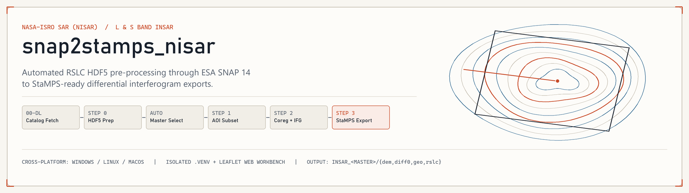
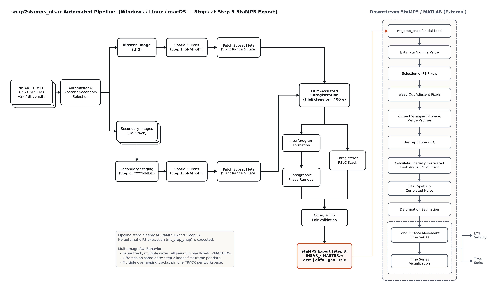

<div align="center">



<p>
  <a href="#workflow-architecture">Architecture</a> &nbsp;&middot;&nbsp;
  <a href="#web-workbench-gui">Web Workbench</a> &nbsp;&middot;&nbsp;
  <a href="#quickstart">Quickstart</a> &nbsp;&middot;&nbsp;
  <a href="#pipeline-stages">Pipeline Stages</a> &nbsp;&middot;&nbsp;
  <a href="#multi-image-aoi-behavior">Multi-Image AOI</a> &nbsp;&middot;&nbsp;
  <a href="#known-limitations">Known Limitations</a>
</p>

</div>

`snap2stamps_nisar` automates pre-processing of **NASA-ISRO SAR (NISAR) L1 RSLC** HDF5 scenes from catalog download through HDF5 validation, baseline-optimal master selection, spatial subsetting, ESA SNAP 14 DEM-assisted coregistration and topographic phase removal, and **Step 3 StaMPS Export** (`INSAR_<MASTER>/{dem, diff0, geo, rslc}`).

> [!IMPORTANT]
> **Export boundary:** Both `bin/auto_run.py --step all` and the Web Workbench stop cleanly after **Step 3 (`StaMPS Export`)**. Downstream PS point selection (`mt_prep_snap`) and `stamps(1, 8)` time-series unwrapping remain external so you retain full control in StaMPS / MATLAB / Octave.

---

## Why This Exists

Standard Sentinel-1 `snap2stamps` workflows fail out of the box on NISAR SweepSAR RSLC products. This repository resolves the underlying ESA SNAP 14 and data-handling breaks:

- **SweepSAR Coregistration Compatibility**: Uses `DEM-Assisted-Coregistration` with `tileExtensionPercent=400` in [graphs/nisar_coreg_ifg.xml](graphs/nisar_coreg_ifg.xml) instead of Sentinel-1 `Back-Geocoding`, preventing `512x512` tile-boundary clipping.
- **Exact Subset & Metadata Patching**: Reads HDF5 `geolocationGrid` bounds in [bin/nisar_step_1_subset.py](bin/nisar_step_1_subset.py), explicitly selects `i_<POL>,q_<POL>` bands, and updates `slant_range_to_first_pixel`, `range_sampling_rate`, and `centre_lat`/`centre_lon` inside output `.dim` XML metadata.
- **Resumable Multi-GB Downloads**: Filters polarization locally after `asf-search` and uses HTTP `206 Range` resume in [bin/asf_nisar_downloader.py](bin/asf_nisar_downloader.py) for ~25 GB `.h5` granules.
- **Zero-CRLF StaMPS Export Sanitizer**: Normalizes `CRLF` to `LF` in exported `.par` headers while keeping `.lat.par` / `.lon.par` distinct in [bin/nisar_step_3_export.py](bin/nisar_step_3_export.py).
- **Cross-Platform Runtime**: Shared OS path and SNAP `gpt` discovery in [bin/platform_utils.py](bin/platform_utils.py) with UTF-8 subprocess handling across Windows, Linux, and macOS.

---

## Workflow Architecture

<div align="center">
  
</div>

| Documentation Resource | Format | Contents |
| :--- | :--- | :--- |
| [NISAR_INSAR_WORKFLOW.pdf](docs/NISAR_INSAR_WORKFLOW.pdf) | 2-Page Vector PDF | Full-page architecture flowchart, cross-platform setup, and process breakdown |
| [NISAR_INSAR_WORKFLOW_GUIDE.md](docs/NISAR_INSAR_WORKFLOW_GUIDE.md) | Markdown Guide | Technical details on `.venv` isolation, steps, and multi-image AOI edge cases |

---

## Web Workbench GUI

An interactive **HTML, CSS, and JavaScript** web application ([gui/server.py](gui/server.py) + [gui/static/](gui/static/)) designed for simple setup without CLI friction, running inside an isolated `.venv` so ArcGIS Pro (`arcgispro-py3`) or global Python installs never interfere:

<table>
  <tr>
    <td width="50%" valign="top">
      <strong>1. Setup &amp; Config</strong><br><br>
      &bull; One-click <strong>Environment &amp; Dependencies Check</strong> (<code>pip install -r requirements.txt</code> with live install log).<br>
      &bull; India-focused open-source <strong>Leaflet map</strong> with basemap switcher (<em>OpenStreetMap</em>, <em>OpenTopoMap Terrain</em>, <em>OSM Humanitarian</em>, <em>Satellite Imagery</em>) and rectangle drawing synced to bounding-box fields.<br>
      &bull; Guided form saving directly to <code>bin/project_nisar.conf</code> without exposing stored passwords.
    </td>
    <td width="50%" valign="top">
      <strong>2. Run, Logs &amp; Output Inspector</strong><br><br>
      &bull; Plain-language step guide and individual buttons from <strong>Download</strong> through <strong>Step 3: StaMPS Export</strong> (plus <em>Run All 0 to 3</em> and <em>Stop</em>).<br>
      &bull; Live streaming stdout console with log copy/clear and saved <code>logs/</code> viewer.<br>
      &bull; Temporal vs. perpendicular baseline chart, baseline ledger, <code>INSAR_&lt;MASTER&gt;</code> readiness check, and interferogram quicklook viewer.
    </td>
  </tr>
</table>

---

## Quickstart

### Prerequisites

- **Python**: `3.10` to `3.13` in an independent virtual environment (`.venv`)
- **ESA SNAP**: `14.0+` with Microwave Toolbox (`NisarRSLCProductReader`, `DEM-Assisted-Coregistration`, `Interferogram`, `TopoPhaseRemoval`, `StampsExport`)
- **StaMPS** *(optional downstream)*: `v4.1b+` with MATLAB or GNU Octave for external `mt_prep_snap` and `stamps(1, 8)`

### Launch the Web Workbench

<table>
  <tr>
    <th>Windows (PowerShell / CMD)</th>
    <th>Linux / macOS (Bash)</th>
  </tr>
  <tr>
    <td>
<pre><code>python -m venv .venv
.\.venv\Scripts\python.exe -m pip install -r requirements.txt
.\launch_workbench.bat</code></pre>
    </td>
    <td>
<pre><code>bash launch_workbench.sh</code></pre>
<em>Bootstraps <code>.venv</code> automatically on first launch.</em>
    </td>
  </tr>
</table>

The Workbench opens at `http://127.0.0.1:8501`.

### Run via CLI

```bash
# Copy configuration template and edit paths, AOI, track, and credentials
cp bin/project_nisar.conf.example bin/project_nisar.conf

# Run Steps 0 through 3 end-to-end (stops at INSAR_<MASTER> export)
python bin/auto_run.py -F bin/project_nisar.conf --step all
```

<details>
<summary><strong>Step-by-step CLI commands &amp; Repository Layout</strong></summary>

```bash
python bin/auto_run.py -F bin/project_nisar.conf --step download
python bin/auto_run.py -F bin/project_nisar.conf --step 0
python bin/auto_run.py -F bin/project_nisar.conf --step automaster
python bin/auto_run.py -F bin/project_nisar.conf --step 1
python bin/auto_run.py -F bin/project_nisar.conf --step 2
python bin/auto_run.py -F bin/project_nisar.conf --step 3
```

```text
snap2stamps_nisar/
├── bin/
│   ├── project_nisar.conf.example   # Configuration template
│   ├── platform_utils.py            # Windows / Linux / macOS SNAP GPT & path helpers
│   ├── auto_run.py                  # CLI orchestrator (Download / Steps 0..3)
│   ├── asf_nisar_downloader.py      # NASA ASF catalog search & HTTP Range downloader
│   ├── bhoonidhi_nisar_downloader.py# ISRO Bhoonidhi STAC client (experimental)
│   ├── friendly_logger.py           # Logging & error translator
│   ├── nisar_step_0_prep.py         # HDF5 validator & date staging
│   ├── nisar_automaster.py          # Optimal master selector & baseline table
│   ├── nisar_step_1_subset.py       # SNAP GPT spatial subset + .dim metadata patcher
│   ├── nisar_step_2_coreg_ifg.py    # Batch DEM-Assisted Coregistration & IFG
│   └── nisar_step_3_export.py       # Batch StampsExport & CRLF -> LF sanitizer
├── docs/
│   ├── readme_hero.png              # Project hero banner
│   ├── nisar_workflow_diagram.png   # Flowchart raster export
│   ├── nisar_workflow_diagram.svg   # Flowchart vector export
│   ├── NISAR_INSAR_WORKFLOW.pdf     # Printable workflow specification
│   └── NISAR_INSAR_WORKFLOW_GUIDE.md# Cross-platform technical guide
├── graphs/
│   ├── nisar_coreg_ifg.xml          # SNAP 14 Coregistration + IFG + TopoPhaseRemoval graph
│   └── nisar_stamps_export.xml      # SNAP 14 StampsExport graph
├── gui/
│   ├── server.py                    # FastAPI backend & live process manager
│   ├── backend.py                   # Config, workspace scanner & doctor
│   ├── static/                      # HTML, CSS & JS Leaflet Workbench UI
│   ├── run_dashboard.bat            # Windows GUI launcher (.venv)
│   └── run_dashboard.sh             # Linux/macOS GUI launcher (.venv)
├── launch_workbench.bat             # Root Windows launcher (.venv)
├── launch_workbench.sh              # Root Linux/macOS launcher (.venv)
├── tests/
│   └── test_prep_auto.py            # Automated unit tests
├── .gitattributes
├── .gitignore
└── requirements.txt
```

</details>

---

## Pipeline Stages

| Stage | Script | Output Folder / Artifacts | Key Operation |
| :--- | :--- | :--- | :--- |
| **Download** | `asf_nisar_downloader.py` | `raw/*.h5` | Query AOI + Track, filter polarization locally, HTTP `206` download |
| **Step 0** | `nisar_step_0_prep.py` | `secondaries/<YYYYMMDD>/` | Validate `/science/LSAR` (or `SSAR`) HDF5 structure and orbits |
| **Automaster** | `nisar_automaster.py` | `master/`, `baselines_table.txt` | Minimize perpendicular & temporal dispersion to pick central Master |
| **Step 1** | `nisar_step_1_subset.py` | `subsets/{master,secondaries}/` | Crop `i_<POL>,q_<POL>` via `geolocationGrid` and patch `.dim` metadata |
| **Step 2** | `nisar_step_2_coreg_ifg.py` | `coreg/*.dim`, `ifg/*.dim` | `DEM-Assisted-Coregistration` (`tileExtensionPercent=400`) + IFG |
| **Step 3** | `nisar_step_3_export.py` | `INSAR_<MASTER>/{dem,diff0,geo,rslc}` | `StampsExport` + `CRLF -> LF` header sanitization (**pipeline stops here**) |

---

## Multi-Image AOI Behavior

- **Multiple dates on one Track (supported):** All dates intersecting your AOI on the selected `TRACK` are staged, subsetted, coregistered to the Master, and exported into one `INSAR_<MASTER>` stack.
- **AOI across two frames on the same date (limitation):** Step 0 and Step 1 keep both frames, but [bin/nisar_step_2_coreg_ifg.py](bin/nisar_step_2_coreg_ifg.py) deduplicates by `<YYYYMMDD>` and **processes only the first frame per acquisition date** (no slice mosaic operator is included). Keep the AOI within a single frame boundary or use separate workspaces.
- **Multiple overlapping Tracks:** Always pin one `TRACK` number per `PROJECTFOLDER` so scenes share viewing geometry.

---

## Known Limitations

> [!WARNING]
> **Verification scope:** End-to-end execution is verified through StaMPS export (`INSAR_<MASTER>/` binary stacks and sanitized headers). Downstream MATLAB / GNU Octave `stamps(1, 8)` unwrapping and velocity inversion have not yet been verified in automated CI.

- **ESA SNAP 14 Required for Production Runs:** If SNAP `gpt` is absent, Step 1's pure-Python fallback slices the array center rather than true georeferenced lat/lon bounds.
- **ISRO Bhoonidhi Client:** `bin/bhoonidhi_nisar_downloader.py` is experimental and has not been validated against live production Bhoonidhi endpoints.
- **Test Coverage:** `python -m unittest discover -s tests -v` covers synthetic Step 0, Automaster, Step 1 fallback, and candidate-prep checks; Step 2/3 SNAP execution and downloaders require real local SNAP/credentials.

---

## License

Open-source under the Apache 2.0 / MIT License.
