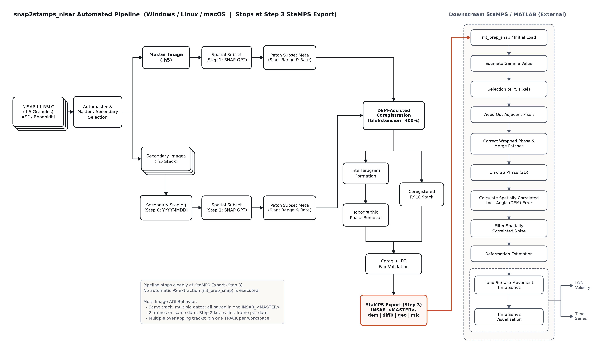

# `snap2stamps_nisar` Workflow & Architecture Guide

End-to-end technical guide for processing **NASA-ISRO SAR (NISAR) L1 RSLC HDF5** imagery through **ESA SNAP GPT** into **StaMPS-compatible export folders** (`INSAR_<MASTER>/dem`, `diff0`, `geo`, `rslc`) across **Windows, Linux, and macOS** without running downstream `mt_prep_snap` PS candidate extraction.

---

## 1. Cross-Platform Independent Python Environment (Windows / Linux / macOS)

If ArcGIS Pro (`arcgispro-py3`) or a system Python appears earlier on your `PATH`, running bare `python` fails with missing dependencies (`No module named fastapi`). Use the project-isolated `.venv` environment on every platform:

```powershell
# Windows (PowerShell / CMD)
.\launch_workbench.bat
# Or invoke directly:
.\.venv\Scripts\python.exe gui/server.py --port 8501 --open
.\.venv\Scripts\python.exe bin/auto_run.py -F bin/project_nisar.conf --step all
```

```bash
# Linux / macOS (creates .venv automatically on first run if absent)
bash launch_workbench.sh
# Or invoke CLI directly inside .venv:
.venv/bin/python bin/auto_run.py -F bin/project_nisar.conf --step all
```

ESA SNAP `gpt` discovery ([bin/platform_utils.py](../bin/platform_utils.py)) checks `SNAP_INSTALLATION_FOLDER`, `PATH`, and OS-standard locations across Windows (`C:\Program Files\esa-snap\bin\gpt.exe`), macOS (`/Applications/esa-snap/bin/gpt`), and Linux (`~/esa-snap/bin/gpt`, `/usr/local/esa-snap/bin/gpt`, `/opt/esa-snap/bin/gpt`).

---

## 2. End-to-End Processing Flowchart (Stops at Step 3: StaMPS Export)



*(Vector version: [nisar_workflow_diagram.svg](nisar_workflow_diagram.svg) | Printable 2-page PDF: [NISAR_INSAR_WORKFLOW.pdf](NISAR_INSAR_WORKFLOW.pdf))*

```text
  [ASF / Bhoonidhi Catalog]
             |  (HTTP Range 206 Resumable Download -> raw/*.h5)
             v
  [Step 0: Prep & Validation]  (bin/nisar_step_0_prep.py)
             |  Validates /science/LSAR/RSLC HDF5 groups, extracts orbit vectors,
             |  stages files into secondaries/<YYYYMMDD>/ + nisar_scenes_metadata.json
             v
  [Automaster Selection]       (bin/nisar_automaster.py)
             |  Computes Bperp & Btemp dispersion, selects optimal Master date,
             |  moves master scene -> master/, writes baselines_table.txt
             v
  [Step 1: Spatial Subset]     (bin/nisar_step_1_subset.py)
             |  Reads geolocationGrid from .h5 -> computes pixel region + slant_range_to_first_pixel,
             |  runs SNAP GPT Subset (sourceBands=i_POL,q_POL) -> subsets/{master,secondaries}/*.dim,
             |  patches range_sampling_rate & centre_lat/centre_lon
             v
  [Step 2: Coreg & IFG]        (bin/nisar_step_2_coreg_ifg.py + graphs/nisar_coreg_ifg.xml)
             |  DEM-Assisted-Coregistration (Copernicus 30m DEM, tileExtensionPercent=400) -> coreg/*.dim
             |  Interferogram + TopoPhaseRemoval -> ifg/*.dim
             v
  [Step 3: StaMPS Export]      (bin/nisar_step_3_export.py + graphs/nisar_stamps_export.xml)
             |  Runs SNAP StampsExport on coreg + ifg pairs, sanitizes CRLF -> LF headers
             v
  [INSAR_<MASTER>/ Ready]
      |-- dem/    (DEM elevation products)
      |-- diff0/  (Differential wrapped interferograms)
      |-- geo/    (Orthorectified lat/lon rasters + .par headers)
      '-- rslc/   (Coregistered Master & Secondary SLC binaries)
```

> **Note on PS extraction**: `auto_run.py --step all` and the Workbench GUI intentionally **stop at Step 3 (`StaMPS Export`)**. They do **not** run automatic PS candidate extraction (`mt_prep_snap`); `INSAR_<MASTER>/` is handed off cleanly for external StaMPS / MATLAB / Octave processing.

---

## 3. What Happens When the AOI Lies on Multiple Images?

Depending on how the multiple scenes relate to your AOI and `TRACK` setting in `bin/project_nisar.conf`, the current codebase behaves as follows:

1. **Multi-date stack along the same Track (Standard InSAR Stack — Fully Supported)**
   - **Behavior**: Multiple dates (e.g., 6 dates over Track 55) all covering your AOI are downloaded into `raw/`, staged by `<YYYYMMDD>` in Step 0, ranked in Automaster, subsetted individually in Step 1, coregistered to the Master in Step 2, and exported into `INSAR_<MASTER>/` in Step 3.
2. **AOI straddles two adjacent along-track frames on the SAME date (Known Limitation)**
   - **What happens currently**:
     - `asf_nisar_downloader.py` downloads **both** intersecting `.h5` granules.
     - `nisar_step_0_prep.py` places **both** files inside `secondaries/<YYYYMMDD>/`.
     - `nisar_step_1_subset.py` creates individual `.dim` subsets for **both** files.
     - **Step 2 (`nisar_step_2_coreg_ifg.py`, `find_input_scenes()`) deduplicates strictly by acquisition date (`unique_scenes[dt]`)**: it keeps **only the first file encountered for that `<YYYYMMDD>` and skips the second frame**. There is currently no along-track slice mosaic/concatenation operator prior to Step 2.
   - **Workaround / Mitigation**: Keep the AOI bounding box within a single NISAR frame extent, or process the two frame extents in separate workspaces (`PROJECTFOLDER`).
3. **AOI covered by multiple overlapping Tracks (Ascending + Descending, when `TRACK` is blank)**
   - **What happens currently**:
     - If `TRACK` is left blank, `asf_nisar_downloader.py` downloads scenes from **all** matching tracks.
     - Automaster and Step 2 group scenes solely by date against one Master. Cross-track secondary pairs (different orbital incidence/heading) will fail `DEM-Assisted-Coregistration` or yield distorted/incomplete overlap.
   - **Best Practice**: Always pin a single `TRACK` number per `PROJECTFOLDER` (or create separate `PROJECTFOLDER`s for ascending vs. descending tracks).
